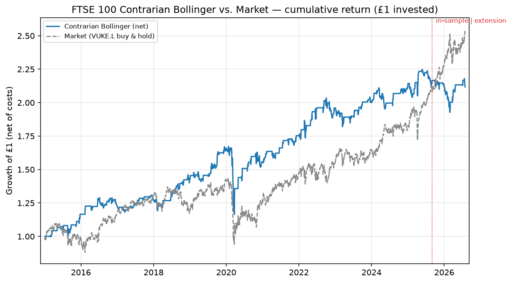

# Momentum & Contrarian Strategies on UK Assets — Extension Study

**A reproducible re-examination of an undergraduate dissertation, extended to July 2026.**
Synthesis of Phases 1–5, with Phase 6 (stock-level generalisation) and Phase 7 (portfolio-construction) addenda; every figure is traceable to a committed output in `reports/`.

---

## Executive summary

This project rebuilt and extended a dissertation testing seven momentum and contrarian
trading strategies on the FTSE 100 (via the VUKE.L ETF) and GBP/USD over 2015–2025. Four
findings stand out. **First, momentum failed structurally on the FTSE 100** — all four
momentum strategies lost money, three significantly underperforming a passive benchmark.
**Second, the one strategy that worked in-sample was the Contrarian Bollinger Band** — 7.6%
CAGR at a 0.69 Sharpe while invested only ~44% of the time — and I reproduced that
independently, within a pre-registered tolerance, on a fresh July 2026 data pull (~11
months after the original sample ended). **Third, that
edge did *not* persist out-of-sample:** over the ~11-month extension it lost 1.5% while the
market rose 21.6%. **Fourth, what survives scrutiny is narrow but real:** the edge is robust
to its parameters, and its high-volatility regime premium holds up (attenuated) once a
look-ahead bias in the original regime labels is removed. The honest conclusion is an edge that
has, at best, narrowed and did not survive the extension — though whether that reflects genuine
decay or simply an unfavourable regime cannot be resolved over ~11 months. Either way, it is not
a deployable edge as it stands.

## What was built

A clean, reproducible Python system: a snapshot-driven data pipeline (results reproduce from
committed CSVs, not live API calls), the seven strategies **re-implemented independently from
the dissertation's written methodology** (not the original code), a shared next-day-execution
backtest engine, regime and robustness analysis, and a minimal live-signal harness. The work
proceeded in gated phases, each with a plan committed before the build and an honest report
committed after.

## Original results, validated

Re-implementing from the paper and running on a fresh 2015–Aug 2025 pull reproduced every
headline figure within tolerance (CAGR ±1pp, Sharpe ±0.1, HAC t ±0.3). Selected FTSE 100
results (mine / dissertation):

| Strategy | CAGR | Sharpe | Note |
|---|---|---|---|
| Market (buy & hold) | 7.2% / 7.2% | 0.46 / 0.46 | anchor matched exactly |
| **Contrarian Bollinger** | **7.4% / 7.6%** | **0.67 / 0.69** | only strategy to beat/match the market |
| Momentum EMA (worst) | −12.0% / −11.8% | −0.77 / −0.76 | −19.5% ann. differential, HAC-significant |

All four momentum strategies produced negative CAGRs; three (SMA, EMA, Lookback)
significantly underperformed the market under HAC-robust testing. GBP/USD showed no
persistent edge for any strategy. The re-implementation deltas ran uniformly *slightly worse*
than the original (consistent with vendor data revisions, and the opposite direction to what
look-ahead bias would cause).

## Extension to July 2026 — did the edge persist?

The chart shows the story at a glance: the Contrarian Bollinger (blue) leads the market
through the in-sample period, then the market pulls decisively ahead after the Aug-2025 split.
Over the extension window (Sept 2025 → Jul 2026, ~230 trading days) the strategy returned
**−1.5% cumulative versus the market's +21.6%.**

> **Directional only.** ~11 months (~100 active days) is far too short for statistical
> significance; no significance is claimed on this window. The verdict is "did not persist,"
> not a quantified decay rate.

## Why performance changed

The extension result is consistent with the dissertation's central thesis: a behavioural,
sentiment-driven edge that erodes as the UK equity market's structure shifts toward passive
ownership, compressing the return autocorrelation that mean-reversion rules exploit. The
strongest single piece of original evidence for that thesis was a **monotonic decay in the
strategy's Fama-French five-factor alpha, from 10.4% (pre-Brexit) to 1.9% (inflation era).**

> **Attribution:** these decay figures (10.4% → 1.9%) are the **original dissertation's
> sub-period finding and were *not* re-derived in this project** — sub-period factor
> attribution was outside the re-implementation scope. They are cited here as context, not as
> an independent reproduction. What *this* project independently establishes is the
> out-of-sample non-persistence above and the regime results below.

## Robustness and the look-ahead fix

Two credibility checks matter most for anyone assessing whether the in-sample edge was real or
curve-fit:

- **Parameter robustness.** The Bollinger edge is positive across almost the entire band-window
  {10–40} × width {1.5–2.5σ} grid — it does not depend on the exact (20, 2σ) choice. The two
  regime-classification parameters flagged by the dissertation's markers were also varied: the
  high-volatility premium stays positive across vol-state windows {10, 20, 40 days} (+7.8 /
  +5.6 / +4.8pp) and the low-rate outperformance stays positive across Bank Rate thresholds
  {0.5%, 1%, 2%} (+7.0 / +4.8 / +7.2pp). The finding does not hinge on those choices.
- **Removing a look-ahead bias.** The original labelled volatility regimes using the *full
  sample* — information a real-time trader would not have had. Re-estimating with a
  walk-forward Markov model (parameters fit only on the expanding past window; one-sided
  filtered probabilities) attenuates the high-volatility premium from the original **15.8% to
  13.1%** (vs 6.1% in low-vol) — smaller, but still clearly present. The 13.1% is the honest
  number; the 15.8% used information unavailable in real time.

## Limitations — what decayed, why, and what I'd test next

This section is deliberately the most developed part of the report: the conclusions are only
as good as the caveats attached to them.

**The most damaging limitation, stated plainly: the extension cannot distinguish decay from an
unfavourable regime.** A contrarian, mean-reversion strategy that is in cash ~56% of the time
(and net-long only a minority of days) will *structurally* lag a strong, one-directional bull
market — and the
extension window was exactly that (the market rose 21.6%). So the strategy's −1.5% is as
consistent with "contrarian strategies trail in a rally" as it is with "the edge has decayed."
The "Why performance changed" section above should be read with this in mind: the extension is
*consistent with* the decay thesis but does not, on its own, establish it.
*What would actually resolve it — the clear next step, not built here:* a **regime-matched
out-of-sample comparison**, measuring how the strategy performs specifically in *trending*
versus *choppy / high-volatility* out-of-sample stretches, rather than over a single calendar
window dominated by one regime. That is the test that would separate genuine decay from
regime drag.

**The in-sample edge is subject to multiple-testing / selection bias.** Seven strategies across
two assets and several regime cuts is a large hypothesis family, and the Contrarian Bollinger
was in part *selected because it worked*. The parameter-robustness grid guards against
knife-edge overfitting, but it is itself in-sample, so it does not correct for the strategy
having been chosen ex-post. Harvey, Liu and Zhu (2016) show that isolated "significant" results
within large families are frequently chance. *Next step:* a **deflated Sharpe ratio or
bootstrap** that explicitly penalises for the number of strategies and parameter combinations
tried.

**The extension window is short (~11 months, ~100 active days).** It supports a directional
read only; no significance is claimed. *Next step:* re-run periodically as more out-of-sample
data accrues.

**Single-ETF proxy and a lower-bound cost model.** VUKE.L carries tracking error versus the
index itself, and the 0.04% round-trip cost model excludes CFD financing, market impact, and
elevated short-selling costs during stress — so realised costs would be higher, especially on
the short leg. *Next step:* re-price under a stress-dependent cost model.

**Low factor explanatory power.** FF5 R² is ~0.15 — standard factors explain little of these
daily strategy returns (partly a currency mismatch: European factors in USD vs GBP returns), so
factor attribution can neither confirm nor rule out an omitted-risk explanation for the alpha.

**Deferred by design.** The event studies (FOMC/Trump/BoE) were not re-run; the markers
themselves flagged that daily-frequency event windows are ill-identified, so this is a known,
deliberate gap rather than an oversight.

**Reference-data caveat.** The Bank Rate series is a manually-entered static snapshot of the
official BoE schedule; the threshold-driving values are the well-established ones, but it should
be spot-checked before being quoted precisely.

## The live signal

A minimal harness (`live_signal.py`) generates the current Bollinger signal and logs it. It is
a **capability demonstration only** — no broker, no capital, no orders — and, given the
non-persistence finding above, explicitly **not** a system I would trade.

## Stock-level generalisation check (Phase 6)

A generalisation check (`reports/phase6_stock_generalisation.md`) applied the exact validated
Contrarian Bollinger strategy to eight individual FTSE 100 constituents, one per sector, over the
original 2015–Aug 2025 window — a **mechanism check, not a signal search**. The result is an
honest null: five of eight names showed a positive strategy CAGR and three beat their own
buy-and-hold, but **none was HAC-significant even at a raw α=0.05, and none survived a Bonferroni
correction** (α/8 ≈ 0.00625) for the eight parallel tests. This is entirely consistent with the
index-level non-persistence above: the edge does not generalise to single names, reinforcing that
the in-sample result was an artefact rather than a robust, tradable phenomenon.

## Portfolio construction — a capability demonstration (Phase 7)

A later extension (`reports/phase7_portfolio.md`) steps up from single strategies to the
portfolio level: an inverse-volatility-weighted portfolio of eight single-name Contrarian
Bollinger sleeves, reported with portfolio-level risk metrics (return, volatility, Sharpe,
correlation structure, drawdown). It is a **construction-capability demonstration, not a tradable
portfolio** — it is built on the same Contrarian Bollinger signal shown above to fail
out-of-sample and (across eight individual stocks, Phase 6) to lack any statistically significant
edge, so every figure is in-sample and inherits that null result. In-sample the inverse-vol
portfolio shows a higher Sharpe (0.54 vs 0.30) and a shallower drawdown (−18.8% vs −27.5%) than an
equal-weight buy-and-hold of the same names — but that improvement is **mechanical, not alpha**:
the portfolio sits in cash ~48% of the time and deliberately sizes down the most volatile names,
and its return is statistically indistinguishable from the benchmark (HAC p = 0.89). The point is
to demonstrate portfolio sizing, correlation, and drawdown assessment — including that the
in-sample correlations are unstable (mean pairwise 0.21 → 0.04 across the two halves of the
sample) — not to propose anything to trade.

## Conclusion

Momentum is structurally broken on the FTSE 100 in the passive-investing era. The Contrarian
Bollinger Band captured a genuine behavioural premium in-sample — robust to its parameters and
concentrated in high-volatility, low-rate conditions — but that premium has, at best, narrowed:
it did not survive the out-of-sample extension, and it shrinks once a look-ahead bias is removed.
Whether the out-of-sample failure reflects genuine decay or simply an unfavourable regime cannot
be settled over ~11 months, and the report is explicit about that. The defensible takeaway is not
"here is a strategy that beats the market," but "here is a once-promising edge, honestly measured,
that no longer clears the bar — with the open question of why stated plainly."
